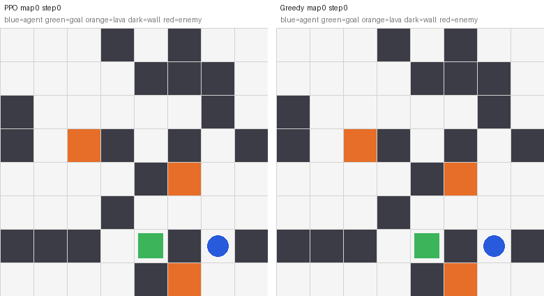
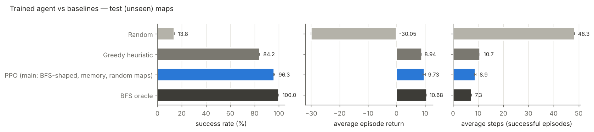
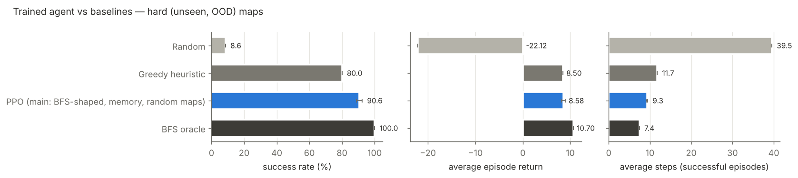
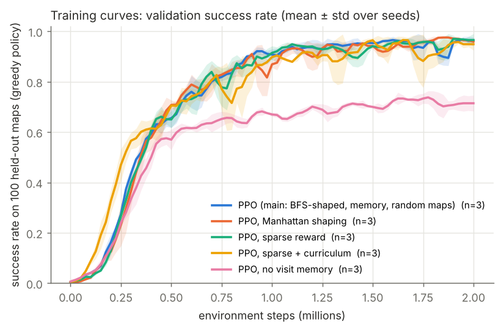
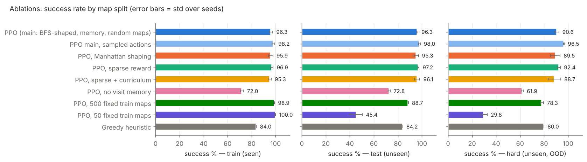
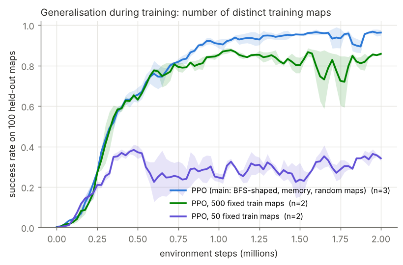
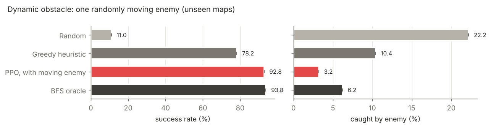
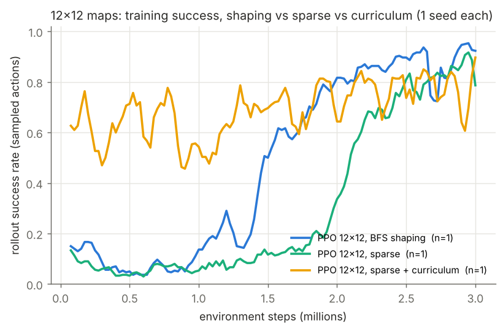
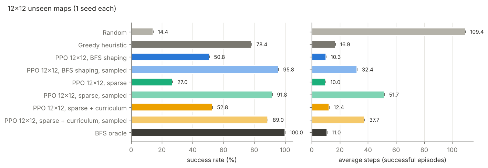
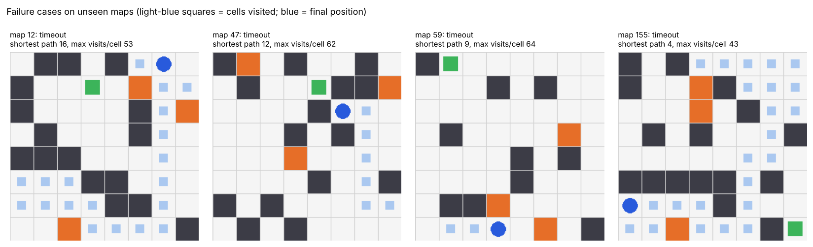

# Goal-Seeking GridWorld Agent (PPO)

A reinforcement-learning agent that learns to reach a goal while getting around walls and avoiding lava. **Every episode uses a new, randomly generated map**, so the agent has to learn a general navigation skill rather than memorise one layout. All numbers below come from `python run_all.py` and are reproducible (fixed seeds, fixed map splits).



*Left: trained PPO agent. Right: greedy heuristic baseline. Both play the same unseen test maps. The greedy agent gets stuck behind U-shaped walls; the PPO agent goes around them.*

## TL;DR

Results on **500 unseen maps** (none of them seen during training or used for model selection), mean ± std over 3 training seeds:

| Agent | Success % | Avg. episode return | Avg. steps to goal | SPL ¹ |
|---|---|---|---|---|
| Random actions | 13.8 | −30.05 | 48.3 | 0.03 |
| Greedy heuristic (baseline) | 84.2 | 8.94 | 10.7 | 0.70 |
| **PPO (this work)** | **96.3 ± 0.5** | **9.73 ± 0.47** | **8.9 ± 0.2** | **0.87 ± 0.01** |
| PPO, sampled actions ² | 98.0 ± 0.7 | 9.98 ± 0.17 | 11.1 ± 0.3 | 0.81 ± 0.01 |
| BFS shortest path (oracle upper bound) | 100.0 | 10.68 | 7.3 | 1.00 |

On **harder out-of-distribution maps** (30% walls instead of 20%, 6 lava cells instead of 3), PPO reaches 90.6 ± 1.8% and the greedy heuristic reaches 80.0%.

¹ SPL = success weighted by (shortest path / actual path length) (Anderson et al., 2018). 1.0 means the agent always takes a shortest path.
² Same network, but actions are sampled from the policy instead of taking the argmax. See [Failure cases](#9-failure-cases) for why sampling helps.

The three findings that shaped the design:

1. **A memoryless policy loops forever.** The first PPO version (no memory, 500 fixed training maps) scored 95% on its training maps but only 66% on unseen maps, which is worse than the greedy heuristic. Almost every failure was a timeout: the deterministic policy walked back and forth between two cells. Adding one observation channel with the episode's visit count per cell fixed most of this. With random maps in both cases, success goes from 72.8% without the channel to 96.3% with it (ablation E3).
2. **Map diversity matters more than training length.** With 50 fixed training maps the agent gets 100% on those maps and only 45% on unseen ones. With 500 maps it gets 88.7% on unseen ones, and with a fresh random map every episode it gets 96.3% (E4).
3. **Reward shaping only pays off when exploration is hard.** On 8×8 maps the sparse reward learned as fast as the shaped one, because random actions already reach the goal in about 14% of episodes. On 12×12 maps, shaping got the agent to 50% training success about 0.6M steps sooner (1.5M against 2.1M steps) and gave a better final policy (E1, E6).

---

## Quick start

Python 3.10–3.12. A CPU is enough; no GPU is needed.

```bash
# Windows: run in "Anaconda Prompt". Linux/macOS: any terminal.
conda create -n gridrl python=3.11 -y
conda activate gridrl
pip install -r requirements.txt

python run_all.py --quick      # smoke test: 1 seed per experiment, 300k steps (~15-20 min)
python run_all.py              # full reproduction (≈4 h on 2 CPU cores, much faster with more cores)
```

The trained models are included in `models/`, so you can regenerate the evaluation, plots and demo without retraining. (The lightweight package includes only the main agent, `models/ppo_shaped_s0.zip`. In that case `python run_all.py` retrains just the missing models, because it skips any model that already exists.)

```bash
python evaluate_all.py         # -> results/summary.md, summary.csv, metrics_per_seed.csv
python plots.py                # -> results/*.png
python demo.py                 # -> results/demo.gif
python failure_cases.py        # -> results/failure_cases.png
```

To train a single agent:

```bash
python train.py --name ppo_shaped --shaping bfs --pool-size 0 --seed 0
```

## Project layout

```
gridworld_rl/
  env.py          GridWorldEnv (Gymnasium API): map generator, observation, reward, rendering
  baselines.py    Random, Greedy heuristic, BFS oracle
  evaluate.py     batched evaluation on a fixed list of maps (one episode per map)
  maps.py         reproducible, de-duplicated train / validation / test / hard map splits
train.py          PPO training (Stable-Baselines3) + validation logging + curriculum
evaluate_all.py   evaluates every saved model and every baseline on every split
plots.py          training curves, comparison and ablation charts, sample-efficiency table
demo.py           side-by-side GIF of PPO vs greedy
failure_cases.py  finds and draws failure episodes
run_all.py        runs all experiments end to end
models/           best-on-validation checkpoints used for every number in this README
models/final/     last checkpoint of each run (created by training; not shipped, to save space)
results/          plots, tables, per-run training curves (results/curves/*.csv)
```

---

## 1. Environment

The GridWorld is custom-built and follows the Gymnasium API (it passes `gymnasium.utils.env_checker`).

- **Map:** 8×8 cells. Each cell is a wall with probability 0.2. There are 3 lava cells, one start cell and one goal cell.
- **Solvability:** maps are regenerated until the goal can be reached from the start without touching lava, and the shortest path is at least 4 steps long (BFS check). On the test maps the mean shortest path is 7.3 steps and the longest is 20.
- **Episode end:** reaching the goal, stepping into lava, or 128 steps (timeout).
- **Optional dynamic obstacle** (`--enemies 1`): an enemy takes a random legal step every turn. Touching it ends the episode.

**Map splits** (`gridworld_rl/maps.py`) are generated from different seeds and de-duplicated against each other:

| Split | Maps | Used for |
|---|---|---|
| train pool | 500 | training, only for the fixed-pool agents of E4 |
| validation | 100 | learning curves and checkpoint selection |
| test | 500 | every headline number; never used during development of a run |
| hard (OOD) | 500 | 30% walls and 6 lava cells: a harder distribution than training |

The main agent trains on **freshly generated maps** (`--pool-size 0`), so it has never seen any specific test map.

## 2. State / observation representation

The observation is an **egocentric** stack of binary planes, size `(5, 15, 15)`, flattened to 1125 values. It is a (2N−1)×(2N−1) crop centred on the agent, so the whole map is always visible wherever the agent stands:

| Channel | Content |
|---|---|
| 0 | walls (cells outside the map also count as walls) |
| 1 | lava |
| 2 | goal |
| 3 | enemy (empty unless dynamic obstacles are on) |
| 4 | episodic visit count of each cell, `min(count, 3) / 3` |

Why this design:

- **Egocentric rather than absolute coordinates.** "Wall directly to my right" looks identical anywhere on the map, so the policy learns one rule instead of 64 position-specific ones. This translation equivariance is what makes generalisation to new layouts possible.
- **Full map rather than a small local view.** Getting around a wall needs information beyond the adjacent cells. A local window would turn the task into a POMDP.
- **Visit-count channel.** Without memory, the same observation always produces the same action. If that action leads into a two-cell loop, a deterministic policy repeats it until the timeout. The visit channel makes revisits observable, so the policy can learn "don't go back where I just was". It is cheap memory, an alternative to an RNN, and it also acts like count-based exploration. Removing it is ablation E3.

## 3. Action space

`Discrete(4)`: up, right, down, left. Moving into a wall or off the map leaves the agent where it is and is penalised.

## 4. Reward design

| Event | Reward | Why |
|---|---|---|
| reach goal | **+10** (episode ends) | the objective |
| step into lava | **−5** (episode ends) | hazard; ending the episode makes it costlier than the per-step cost of a long detour |
| bump into wall / edge | **−2** | the agent stays put, so without a penalty bumping is a free "wait" action |
| every step | **−0.01** | mild pressure towards short paths |
| shaping | **F = γ·Φ(s′) − Φ(s)**, with Φ(s) = −0.1 · d(s, goal) and Φ(terminal) = 0 | dense progress signal (see below) |

**Why potential-based shaping instead of "+0.1 for moving closer".** The example reward in the brief ("+0.1 for moving closer") can be exploited. An agent that steps away and back again collects +0.1 on every return trip, and moving closer to the goal in Manhattan distance can mean walking into a dead end. Potential-based shaping (Ng, Harada & Russell, 1999) adds γΦ(s′) − Φ(s). Over any trajectory the shaping terms telescope, so no loop can earn net reward, and the optimal policy of the shaped MDP is provably the same as that of the unshaped one. The shaping makes learning easier without changing what "optimal" means.

**Which distance?** The main agent uses the true shortest-path (BFS) distance to the goal, which respects walls. Ablation E1 compares it with the Manhattan distance (cheaper, but it points through walls) and with no shaping at all (the sparse reward). One caveat: BFS shaping uses privileged map information at **training** time, like a teacher signal. The policy itself only sees the observation above, and the sparse-reward agent shows the shaping is not essential on 8×8 maps.

**Same yardstick for everyone.** All agents, including baselines and agents trained on sparse or Manhattan rewards, are *evaluated* under the reward in the table above. That makes "average episode return" comparable across rows. Because the shaping telescopes, an optimal agent's return is about 10 + 0.1·(start distance) − 0.01·steps, which is why the BFS oracle averages 10.68.

## 5. RL algorithm and training setup

**PPO** (Stable-Baselines3), chosen because:

- it is stable with little tuning on discrete-action tasks;
- it is on-policy with parallel environments, which suits a fast simulator where samples are cheap;
- its entropy bonus gives a simple, controllable exploration mechanism.

DQN would also work. Its replay buffer is more sample-efficient, but samples are not the bottleneck here, and DQN tends to be more sensitive to hyperparameters.

| Setting | Value |
|---|---|
| Policy / value network | separate MLPs for policy and value, each 1125 → 256 → 256 (tanh), SB3 `MlpPolicy` |
| Parallel envs | 8 (`DummyVecEnv`) |
| Rollout | 256 steps × 8 envs = 2048 samples per update |
| Minibatch size / epochs | 512 / 4 |
| Learning rate | 3e-4 (constant) |
| γ / GAE λ / clip | 0.99 / 0.95 / 0.2 |
| Entropy coefficient | 0.01 (the exploration strategy) |
| Training budget | 2M env steps per run (≈12 min on one CPU core) |
| Seeds | 3 per main condition (2 for the map-pool runs, 1 for the enemy and 12×12 runs) |
| 12×12 runs | same settings, 3M steps |
| Checkpoint selection | every 25k steps, evaluate on the 100 validation maps; keep the best (success, then return) |
| Evaluation | 1 episode on each of the 500 test maps, greedy (argmax) actions unless stated otherwise |

I also tried a small CNN feature extractor. In a pilot without the visit channel, it learned much more slowly on CPU (≈40% validation success after 1.5M steps, against ≈70% for the MLP under the same setup), so the MLP was kept. With more compute, a CNN is the natural choice for larger maps.

## 6. Baselines

- **Random:** uniformly random actions. A lower bound.
- **Greedy heuristic:** among the neighbouring cells that are not wall, lava or enemy, step to the one that most reduces Manhattan distance to the goal, breaking ties at random. If none reduces it, take a random safe step. The heuristic **reads the true map** and never touches lava, so it is a strong, reasonable baseline. Its weakness is the lack of planning: it gets stuck behind concave walls.
- **BFS oracle:** follows the true shortest path. This is an upper bound for reference, not a baseline to beat. With a moving enemy it ignores the enemy, so it is no longer optimal.

---

## 7. Results

The full tables for every split are in [`results/summary.md`](results/summary.md), per-seed numbers are in `results/metrics_per_seed.csv`, and raw learning curves are in `results/curves/`.

### 7.1 Trained agent vs baselines




| Unseen maps | Random | Greedy | **PPO** | PPO (sampled) | BFS oracle |
|---|---|---|---|---|---|
| test: success % | 13.8 | 84.2 | **96.3 ± 0.5** | 98.0 ± 0.7 | 100 |
| test: avg return | −30.05 | 8.94 | **9.73 ± 0.47** | 9.98 ± 0.17 | 10.68 |
| test: avg steps (successes) | 48.3 | 10.7 | **8.9 ± 0.2** | 11.1 ± 0.3 | 7.3 |
| hard (OOD): success % | 8.6 | 80.0 | **90.6 ± 1.8** | 96.5 ± 0.4 | 100 |

PPO beats the heuristic most clearly on long, winding paths. The breakdown below is from `failure_cases.py`, PPO seed 0, test maps:

| Shortest path length | Maps | PPO success | Greedy success | PPO extra steps vs optimal |
|---|---|---|---|---|
| 1–5 | 153 | 98.0% | 99.3% | 0.6 |
| 6–9 | 255 | 97.3% | 85.5% | 1.4 |
| 10–14 | 83 | 91.6% | 61.4% | 3.8 |
| 15+ | 9 | 55.6% | 0.0% | 11.6 |

### 7.2 Training curves



Validation success on 100 held-out maps (greedy actions), mean ± std over 3 seeds. Return curves: [`training_return.png`](results/training_return.png) uses the common shaped reward and is comparable across agents; [`training_rollout_return.png`](results/training_rollout_return.png) uses each agent's own training reward.

Sample efficiency (from `results/sample_efficiency.md`, 3-point smoothed validation success):

| Condition (8×8) | Seeds | Steps to 50% | Steps to 80% | Steps to 90% | Final val. success (last 200k steps) |
|---|---|---|---|---|---|
| PPO main (BFS shaping) | 3 | 0.35M | 0.68M | 0.90M | 93.8% |
| Manhattan shaping | 3 | 0.36M | 0.65M | 0.89M | 96.7% |
| Sparse reward | 3 | 0.37M | 0.71M | 0.88M | 95.6% |
| Sparse + curriculum | 3 | 0.28M | 0.72M | 0.96M | 94.9% |
| No visit memory | 3 | 0.40M | never | never | 71.1% |
| 500 fixed training maps | 2 | 0.34M | 0.69M | never | 83.6% |
| 50 fixed training maps | 2 | never | never | never | 34.3% |
| With moving enemy | 1 | 0.38M | 0.60M | 0.95M | 93.1% |

"Final val. success" is the average over the last 8 evaluations of each run. The test numbers elsewhere use the best validation checkpoint, which is why they are a little higher.

### 7.3 Ablations



**E1. Reward design** (3 seeds each, unseen test maps)

| Reward | Success % | Steps to 90% val. success |
|---|---|---|
| BFS potential shaping (main) | 96.3 ± 0.5 | 0.90M |
| Manhattan potential shaping | 95.3 ± 1.9 | 0.89M |
| Sparse (goal / lava / bump / step only) | 97.2 ± 0.5 | 0.88M |

On 8×8 maps, shaping makes **no measurable difference**. The differences are within seed noise, and on the hard maps sparse is even slightly ahead. The reason is that the "sparse" task is not really sparse here: with 128 steps on an 8×8 map, random actions reach the goal in about 14% of episodes, so PPO gets plenty of goal signal from the start. Manhattan shaping did not hurt either. Potential-based shaping cannot change the optimal policy, so the only risk would be slower learning, and with walls covering 20% of cells "closer in Manhattan distance" is usually right. E6 tests the case where sparse reward should actually be hard.

**E2. Curriculum (bonus)** (sparse reward, 3 seeds). At the start of training, the start cell is re-sampled so the goal is at most k = 2 BFS steps away. Each time rolling training success reaches 80%, k grows by 2, and past 2N+4 the real start is used (`results/curriculum_schedule.png`). The schedule ran its course within the first ~0.4M steps. Final result on the unseen test maps: 96.1 ± 2.2% success, against 97.2 ± 0.5% for plain sparse (hard maps: 88.7 ± 5.3% against 92.4 ± 1.3%). On 8×8 maps, where plain sparse PPO already explores well enough, the curriculum gives an earlier jump in validation success (it reaches 50% first, at 0.28M against 0.37M steps) but **no final benefit**, and slightly more variance across seeds.

**E3. Observation: no visit memory** (3 seeds)

| | test success | hard success | timeouts (test) |
|---|---|---|---|
| with visit channel (main) | 96.3 ± 0.5 | 90.6 ± 1.8 | 3.7% |
| without | 72.8 ± 0.8 | 61.9 ± 0.8 | 27.2% |

This was the single biggest design decision. Without memory, the agent's successes are very efficient (6.5 steps on average, because it only succeeds on easy maps), but 27% of episodes time out in two-cell oscillations.

**E4. Generalisation to unseen maps (bonus)**



| Training maps | Success on its own training maps | test (unseen) | hard (OOD) |
|---|---|---|---|
| 50 fixed maps (2 seeds) | 100.0 ± 0.0 | 45.4 ± 5.1 | 29.8 ± 2.8 |
| 500 fixed maps (2 seeds) | 98.9 ± 0.1 | 88.7 ± 0.1 | 78.3 ± 1.3 |
| new random map every episode (main) | n/a | 96.3 ± 0.5 | 90.6 ± 1.8 |

With 50 maps the agent memorises them: perfect on the training maps, near-useless elsewhere. The gap shrinks as map diversity grows. Procedural generation removes it almost entirely, and the agent also transfers to the denser hard distribution it never trained on.

**E5. Dynamic obstacle (bonus)** (1 seed, one randomly moving enemy, unseen maps)



| | Random | Greedy | **PPO (trained with enemy)** | BFS oracle (ignores enemy) |
|---|---|---|---|---|
| test success % | 11.0 | 78.2 | **92.8** | 93.8 |
| hard success % | 7.0 | 72.2 | **81.2** | 88.2 |
| test: caught by enemy % | 22.2 | 10.4 | **3.2** | 6.2 |

The agent is caught by the enemy about half as often as the oracle (3.2% against 6.2%), since the oracle walks its shortest path regardless of the enemy, but it takes longer routes (SPL 0.73) and times out more on the dense maps. The enemy's position is visible, but its *motion* is not: the agent sees a snapshot and cannot know where the enemy will step.

**E6. Larger 12×12 maps: when sparse rewards become hard (bonus)** (1 seed each, 3M steps)




Same agent and hyperparameters, but on a 12×12 map (observation 5×23×23, 288-step limit, mean shortest path 11 steps), 3M steps per run. Training success above is measured with sampled actions. The curriculum curve starts high because its early episodes are easy (the goal is placed close to the start), and the agent only faces the full task from 2.4M steps onwards.

| 500 unseen 12×12 maps | argmax actions: success % | sampled actions: success % | sampled: avg steps |
|---|---|---|---|
| Random | — | 14.4 | 109.4 |
| Greedy heuristic | — | 78.4 | 16.9 |
| PPO, BFS shaping | 50.8 | **95.8** | 32.4 |
| PPO, sparse | 27.0 | 91.8 | 51.7 |
| PPO, sparse + curriculum | 52.8 | 89.0 | 37.7 |
| BFS oracle | — | 100.0 | 11.0 |

What this shows:

- **Shaping matters once exploration is hard.** With shaping, rollout success passed 50% at 1.5M steps; with the sparse reward it took 2.1M steps, and for the first ~1.8M steps the sparse agent barely improved. The shaped agent also ended stronger (95.8% against 91.8% on unseen maps with sampled actions) and took much shorter paths (32 against 52 steps).
- **The curriculum** gave the sparse agent useful signal from the very start and produced the best argmax policy (52.8%). With sampled actions it was slightly behind the others, probably because it spent most of its budget on easier sub-tasks (the full task only from 2.4M steps).
- **The "loop" failure mode gets much worse on bigger maps.** With argmax actions all three agents time out on about half the maps. The visit channel is capped at 3 visits, which is too little memory for 12×12 routes. With sampled actions every PPO variant beats the greedy heuristic by a wide margin, but takes long, wandering paths. This is the clearest argument for a recurrent policy or a stronger architecture (Section 10).
- Caveat: this is one seed per condition, so the differences between the three PPO variants are indicative, not conclusive.

---

## 8. Observed agent behaviour

These observations come from watching `results/demo.gif` and the failure renders.

- **Goes around walls instead of into them.** On maps where the greedy heuristic oscillates in front of a concave wall, PPO picks the detour early, often taking the first step *away* from the goal. That is behaviour a greedy rule cannot produce.
- **Never touches lava** (0.1% of test episodes) and almost never bumps walls once trained, both reflecting the large penalties.
- **Near-optimal on easy maps, less efficient on long paths:** 0.6 extra steps on paths of 5 steps or fewer, 3.8 extra steps on paths of 10–14.
- **Uses the visit memory to explore.** When the direct route is blocked, it sweeps along a wall and does not re-enter cells it has visited. That is why its successful paths are sometimes longer than the oracle's.
- **Behaviour converges early:** about 90% validation success after ~0.9M steps, with the rest spent on the long-path tail. The curves are noisy late in training (one seed temporarily dropped to ≈70% at 1.8M steps), which is why the best validation checkpoint is kept rather than the last one.

## 9. Failure cases



On the test maps, the main agent (seed 0) fails on 21 of 500: 20 timeouts and 1 lava. Of the 20 timeouts:

- **18 are two-cell oscillations that appear after the visit channel saturates.** The channel stores `min(count, 3)`. Once both cells of a loop have been visited three times, the observation stops changing between visits, and a deterministic policy repeats the same pair of actions until the time limit. The memory delays loops but cannot rule them out.
- **2 are "wall-bump locks":** the agent pushes into a wall, stays where it is, and gets the same observation again.
- **They cluster on long or winding routes.** Failed maps have a mean shortest path of 10.8 against 7.3 overall, typically where the goal is behind a wall and the first move must go away from it. The greedy heuristic also fails on 13 of these 21 maps.

The **sampled-action** result (98.0% on test, 96.5% on hard) confirms this diagnosis. Sampling breaks the symmetric loops, so the same network fails much less often, at the price of slightly longer paths (SPL 0.81 against 0.87) and occasional lava from unlucky samples (0.6%).

Other weaknesses:

- **Hard distribution:** with denser walls, timeouts rise to 9.2%.
- **Moving enemy:** the agent is still caught in 3–6% of episodes, because it cannot predict the enemy's movement.
- **Bigger maps:** on 12×12 maps the argmax policies time out on about half of the maps (E6). The same loop problem, at a larger scale.

## 10. What I would improve with more time

1. **Real memory instead of a capped counter.** A recurrent policy (`RecurrentPPO` with an LSTM) or an uncapped / log-scaled visit channel would make the loops above observable and should remove most remaining timeouts. A cheaper fix at evaluation time is to sample actions, or to mask the action that reverses the previous move.
2. **A convolutional or value-iteration-style architecture.** Planning around walls is a spatial computation, and a CNN or a Value Iteration Network would scale to larger maps much better than an MLP on a flattened grid. The CNN I tried was too slow on CPU for this budget.
3. **Harder exploration and better exploration methods.** On large maps with sparse reward, try count-based or RND intrinsic rewards, and an automatic curriculum over map size and wall density (not only start distance).
4. **Richer dynamics:** enemies that chase the agent, and stacking the last few frames so motion is observable.
5. **More rigorous statistics:** 5–10 seeds for every condition, confidence intervals (for example bootstrap or rliable's IQM), and hyperparameter sweeps (entropy coefficient, network size, learning-rate annealing).
6. **Train on larger and variable-size maps** by padding the egocentric view, so a single policy works across map sizes.

## Bonus items covered

| Bonus | Where |
|---|---|
| Sparse reward environment | E1 (8×8) and E6 (12×12) |
| Curriculum learning | E2, `--curriculum` (adaptive start-distance schedule) |
| Dynamic obstacles | E5, `--enemies 1` |
| Exploration strategy | entropy bonus; visit-count channel (E3); sampled vs greedy actions at evaluation |
| Generalisation to unseen maps | E4, plus all headline numbers are on unseen maps and a harder OOD split |

## Notes on methodology

- Test maps are generated from a separate seed, de-duplicated against the training pool, and never used for checkpoint selection, which uses the 100 validation maps.
- Every agent is scored on the same 500 maps with the same reward definition, one episode per map.
- "Avg steps" is computed over successful episodes only, otherwise timeouts (128 steps) would dominate. SPL combines success and efficiency in one number.
- A bug found during development, and how it was caught: the first curriculum runs produced numbers identical to the sparse runs, to every decimal place. The cause was that `VecEnv.set_attr` set the curriculum parameter on the `Monitor` wrapper instead of the environment. The fix sets it on `env.unwrapped`, and the curriculum runs were retrained.
